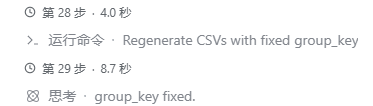

# DSH 工作步骤实时耗时显示

在 DeepSeek Harness（DSH）聊天的**工作详情**视图中，实时显示每个模型步骤的耗时以及最终耗时。



## 功能

- 步骤开始后立即显示紧凑的 `Step N · 4.2s` 标记。
- 步骤运行期间，标记每秒更新一次。
- 步骤结束后，标记冻结为步骤的最终耗时。
- 如果一轮对话被停止或中断，则标记冻结为该轮对话结束时的耗时。
- 显示语言跟随当前启用的 DSH 语言（内置简体中文和英文词典）。
- 标记会随工作详情分组一起折叠，因此隐藏工作行时不会留下孤立的计时器。

## 安装

### 从 GitHub 安装（推荐）

要求：

- 建议使用 DSH `0.2.1-rc.2` 或更高版本；
- 运行 DSH 的机器已安装 Git，并且 Git 可以从命令行调用；
- 插件的 `v1.0.0` 标签已经发布。

在 DSH 中打开**插件**，选择安装插件，输入以下规格：

```text
github:godisonion/dsh-step-duration#v1.0.0
```

也可以让使用 `plugin_manager` 的代理安装该规格。建议固定使用发布标签，而不是 `main` 分支，以确保安装版本可复现。

### 从插件市场安装

本插件可以通过自定义插件市场的 **Discover** 页面安装。由于 DSH 目前没有公开的 Official 市场提交流程，用户需要先添加本插件的市场索引：

1. 打开 **Plugins → Experimental plugins → More**。
2. 启用 **Custom plugin markets**。
3. 打开 **Discover → Add index source**。
4. 添加以下索引地址：
   ```text
   https://godisonion.github.io/dsh-step-duration/index.json
   ```
5. 在 Discover 中找到 **DSH 工作步骤实时耗时显示**，选择安装。

如果索引地址尚未发布或无法访问，请先使用上面的 GitHub 安装方式。

## 兼容性

已使用 DSH `0.2.1-rc.2` 测试。该包声明 `engines.dsh: ">=0.2.1-rc.2"`；DSH 插件管理器会拒绝安装到更早的运行时版本。

## 开发

无需构建步骤，也没有运行时依赖（DSH Web 客户端提供的 React 模块除外）。

```powershell
node --check index.js
node --check client.js
```

通过 DSH 插件管理器安装该包目录，然后验证 `conversation.chat.node` 是否暴露了处于活动状态的 `step-duration` occupant。

## 项目结构

| 文件 | 用途 |
|---|---|
| `client.js` | Conversation Definition、实时计时器组件、插槽注册和本地化内容 |
| `index.js` | Bundle 的宿主端；有意保持为空 |
| `cordis.patch.yml` | 将 Bundle 行插入 DSH 配置文件 |
| `locale/en.json`、`locale/zh.json` | 插件管理器中的插件标题和描述 |
| `icon.svg` | 原始插件图标 |

## 安全

DSH 插件会以**宿主用户的权限在同一进程中运行**。安装前请检查插件源代码。此包未声明安装或构建脚本，也不会发起网络请求。

## 许可证

MIT。详见 [LICENSE](LICENSE)。

---

# DSH Step Duration

Shows every model step's live and final duration in the **Work details** view of DeepSeek Harness (DSH) Chat.


## Features

- A compact `Step N · 4.2s` marker appears as soon as a step starts.
- The marker updates once per second while the step is running.
- It freezes at the step's final duration when `step/end` arrives.
- If a turn ends without `step/end` (stopped or interrupted), the value freezes at the turn end time.
- Display follows the active DSH language (Simplified Chinese and English dictionaries included).
- The marker folds together with the Work details group, so hidden work rows do not leave orphan timers.

## Install

### Install from GitHub (recommended)

Requirements:

- DSH `0.2.1-rc.2` or later is recommended;
- Git installed on the machine running DSH and available from the command line;
- the plugin's `v1.0.0` tag published on GitHub.

In DSH, open **Plugins**, choose to install a plugin, and enter:

```text
github:godisonion/dsh-step-duration#v1.0.0
```

You can also ask an agent with `plugin_manager` to install that spec. Pin a release tag instead of the `main` branch for reproducible installs.

### Install from a plugin market

This plugin can be installed from the **Discover** page of a custom plugin market. DSH currently has no public submission process for the built-in Official catalog, so users must add this plugin's market index first:

1. Open **Plugins → Experimental plugins → More**.
2. Enable **Custom plugin markets**.
3. Open **Discover → Add index source**.
4. Add:
   ```text
   https://godisonion.github.io/dsh-step-duration/index.json
   ```
5. Find **DSH Step Duration** in Discover and install it.

If the index has not been published yet or cannot be reached, use the GitHub installation method above.

## Behavior

- **Step scope:** one marker per DSH model step, measuring `step/start` to `step/end`. This includes the model request and the tool executions in that step.
- **Not per tool call:** individual tool-call durations are not shown separately.
- **Loaded window:** a step needs its `step/start` in the loaded session window. Steps cut off by history pagination do not render a marker.
- **Folded work details:** the marker is part of the work process, so it is hidden while Work details is folded and returns when expanded.

## Compatibility

Tested with DSH `0.2.1-rc.2`. The package declares `engines.dsh: ">=0.2.1-rc.2"`; DSH's plugin manager refuses installations on older runtimes.

## Development

There is no build step and no runtime dependency beyond the React module supplied by the DSH Web client.

```powershell
node --check index.js
node --check client.js
```

Install the package directory through DSH Plugin Manager, then verify that `conversation.chat.node` exposes the active `step-duration` occupant.

## Project layout

| File | Purpose |
|---|---|
| `client.js` | Conversation Definition, live timer component, slot registration, locales |
| `index.js` | Host half of the bundle; intentionally empty |
| `cordis.patch.yml` | Inserts the bundle row into the DSH profile |
| `locale/en.json`, `locale/zh.json` | Plugin Manager title and description |
| `icon.svg` | Original plugin icon |

## Security

DSH plugins run **in-process with the host user's permissions**. Review plugin source before installing it. This package declares no install or build scripts and makes no network requests.

## License

MIT. See [LICENSE](LICENSE).
